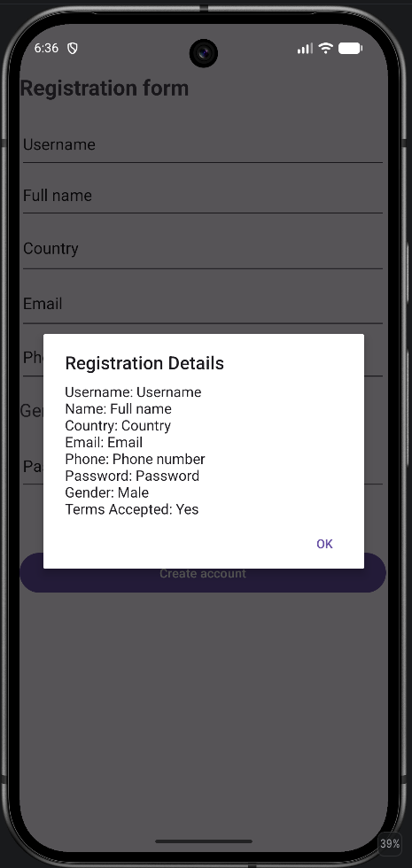
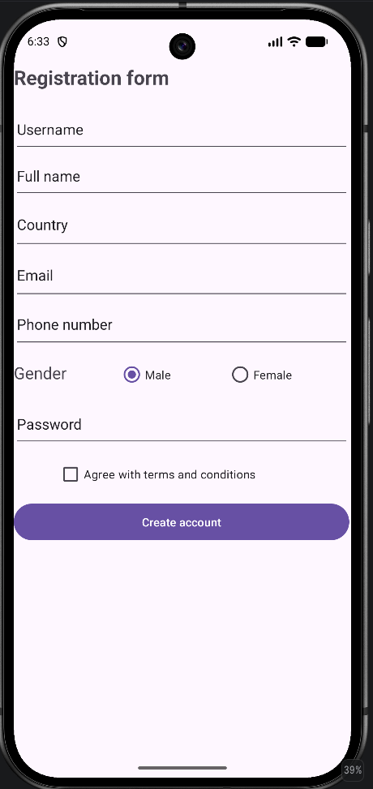

# Izdelava registracijskega obrazca v Android Studio

V Android Studiu sem izdelal registracijski obrazec, ki vključuje naslednje elemente:
- Username
- Fullname
- Country
- Email
- Phone number
- Gender (Male/Female)
- Password
- Checkbox za Terms & Conditions

Aplikacija preveri, ali so vsa obvezna polja vnesena, ter prikaže opozorilo, če katero izmed polj ni izpolnjeno. Ob uspešni registraciji se prikaže okno (`AlertDialog`) z vsemi vnesenimi podatki.

Dostopno je tudi na manjših zaslonih zaradi uporabe `ScrollView`.

### Prikaz na zaslonu:

  
  

